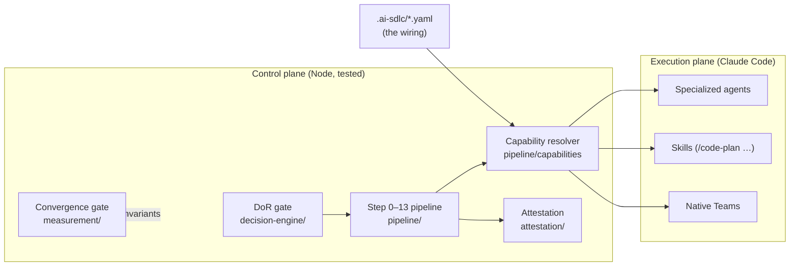
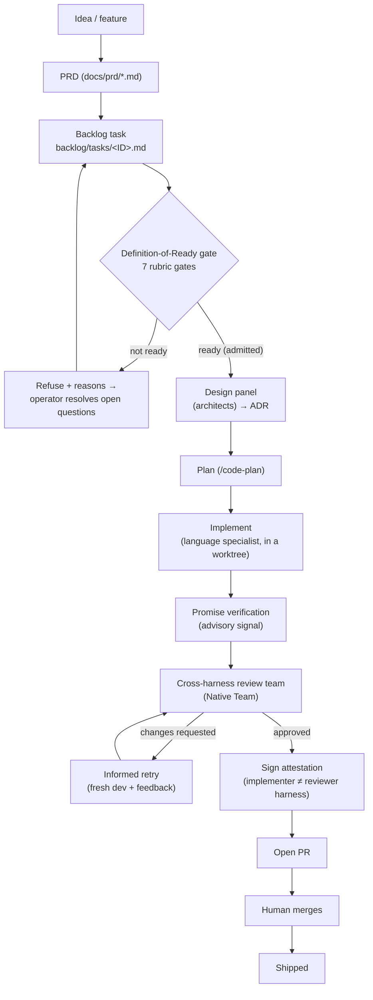
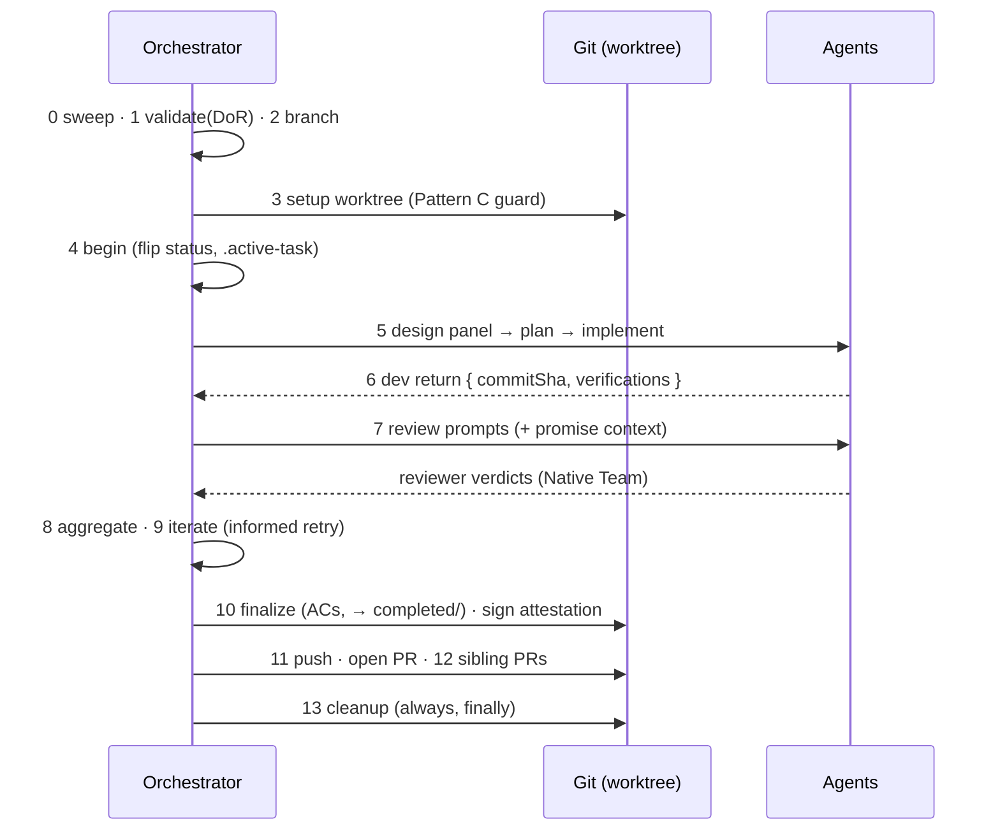
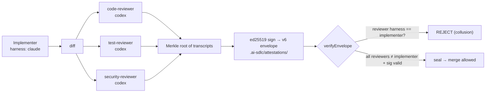
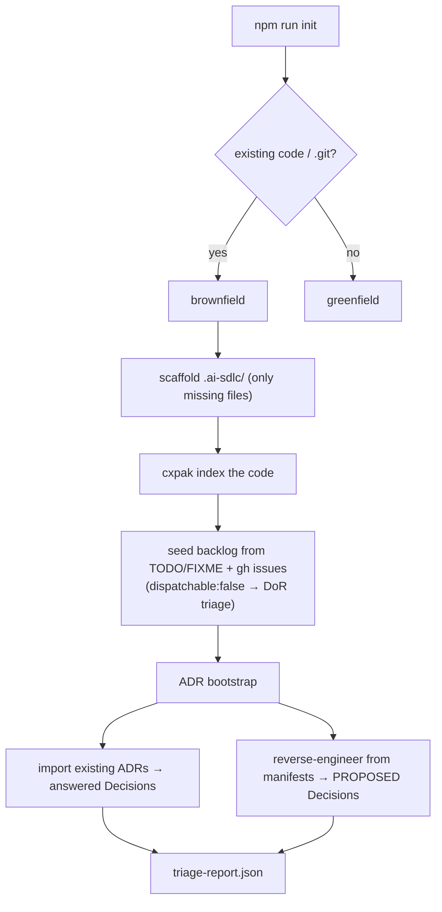

# ai-sdlc

**A Decision Engine for AI software delivery, built on Claude Code.**

`ai-sdlc` turns software delivery into a series of *well-framed decisions the
framework executes deterministically*. Operators front-load the load-bearing
decisions through a Definition-of-Ready gate; an isolated-worktree pipeline
dispatches specialized agents through design → plan → implement → cross-harness
review; every change is sealed with a signed attestation; the pull request opens
itself. The operator's job is **decision steward**, not typist.

It keeps the proven strengths of the earlier promise-theory framework —
token-budgeted **cxpak** context (the measured d=1.82 quality lever), **promise
verification** as an advisory signal, deterministic **hooks**, and a
**measurement** harness — and adds the Decision-Engine control plane on top.

> **Why a Decision Engine?** The framework's own experiments showed that
> injecting feedback into an agent *after* it acts degrades quality (R5 d=−0.64;
> R15 d=−1.37), while structured context *before* it acts is the real win
> (d=1.82). So this framework decides **before** dispatch and never runs a
> feedback-retry loop on the author. See [Research provenance](#research-provenance).

### 📚 Documentation

- **[Getting started](docs/getting-started.md)** — runnable walkthrough (`npm run demo`, adopt a repo, write a task, dispatch it).
- **[Architecture](docs/architecture.md)** — module map, the seam pattern, extension points, design rationale.
- **[Native Teams runbook](docs/operations/native-teams-review.md)** — how the review team maps to Claude Code Native Teams.
- **[PRD guide](docs/prd/README.md)** — feature docs as enforced references.

New here? Run `npm install && npm run demo` to watch one task go through the
whole pipeline in a few seconds.

---

## Table of contents

- [The big picture](#the-big-picture)
- [End-to-end lifecycle](#end-to-end-lifecycle)
- [The Step 0–13 pipeline](#the-step-013-pipeline)
- [Capability map: skills, agents & teams as stages](#capability-map-skills-agents--teams-as-stages)
- [Cross-harness review & attestation](#cross-harness-review--attestation)
- [Decisions (ADRs) & PRDs as enforced references](#decisions-adrs--prds-as-enforced-references)
- [Onboarding an existing project (brownfield)](#onboarding-an-existing-project-brownfield)
- [Multi-repo workspaces (one folder, many repos)](#multi-repo-workspaces-one-folder-many-repos)
- [Using it with Claude Code](#using-it-with-claude-code)
- [Commands & scripts](#commands--scripts)
- [Repository layout](#repository-layout)
- [Testing & gates](#testing--gates)
- [Research provenance](#research-provenance)

---

## The big picture

The framework splits into a **control plane** (plain, fully-tested Node — the
gates, pipeline, resolvers, attestation) and an **execution plane** (Claude Code
— agents, skills, Native Teams, tools). `.ai-sdlc/*.yaml` is the wiring between
them: change *who does what* without touching code.



Operator entry points, all sharing the same tested core:

| Command | What it does |
|---|---|
| `/ai-sdlc:init [dir] [--workspace]` | Scaffold `.ai-sdlc/` + backlog into a repo (brownfield-safe) |
| `/ai-sdlc:new "<title>"` | Product panel (PM/PO, +CMO/CPO if strategic) shapes a **product-only** PRD |
| `/ai-sdlc:design <slug>` | Architect panel → design doc + comprehensive ADRs (the technical *how*) |
| `/ai-sdlc:execute <task-id>` | Full lifecycle for one backlog task |
| `/ai-sdlc:validate [task-id]` | Definition-of-Done gate — build + full tests must pass (hard-enforced) |
| `/ai-sdlc:review [base]` | Just the cross-harness review team on a branch |
| `npm run …` | `init`, `validate-schemas`, `convergence-gate`, `decisions` |

## Install as a Claude Code plugin

The framework ships a plugin manifest (`.claude-plugin/plugin.json`) and a
single-plugin marketplace (`.claude-plugin/marketplace.json`). In any session:

```
/plugin marketplace add cefothe/ai-sdlc
/plugin install ai-sdlc
```

This registers the commands, agents, skills, and all four hooks
(`PreToolUse`, `PostToolUse`, `SessionStart`, `Stop`).

> **One-time step:** the `Stop` hook loads the promise registry via `js-yaml`
> (the only runtime dependency). Plugin installs don't run `npm install`, so run
> it once in the installed plugin directory to activate promise verification:
> `npm install --omit=dev`. Until then the hook degrades gracefully — it logs an
> actionable notice to `promise/logs/hook-errors.jsonl` and never blocks the
> session.

---

## End-to-end lifecycle



The aspirational target (inherited from the reference architecture): a
well-front-loaded task passes this pipeline **unattended ~95% of the time**; the
other 5% surface as decisions the operator missed and feed back into the gate.

---

## The Step 0–13 pipeline

`pipeline/execute.js` runs one admitted task. Deterministic steps are plain Node;
the agent steps go through an injected `spawn` seam (Task tool interactively,
`claude -p` unattended). **Pattern C** is enforced: the parent tree stays
read-only on its base branch; all code work happens in `.worktrees/<task-id>/`.



| Step | Name | Note |
|---|---|---|
| 0 | sweep | remove merged worktrees |
| 1 | validate | DoR gate — abort if not admitted |
| 2 | compute-branch | `ai-sdlc/<id>-<slug>` |
| 3 | setup-worktree | Pattern C: refuses off-branch/dirty parent |
| 4 | begin-task | flip status → In Progress, write `.active-task` |
| 5 | build-dev-prompt | cxpak + design + plan context |
| 6 | parse-dev-return | requires real `commitSha` + `verifications` |
| 7 | build-review-prompts | resolved reviewer team + promise context |
| 8 | aggregate-verdicts | APPROVED iff all approve, no critical/major |
| 9 | iterate | fresh dev **with** reviewer feedback (R16 informed retry) |
| 10 | finalize | verify ACs → Done → `backlog/completed/` |
| 11 | push-and-pr | opens the PR |
| 12 | sibling-prs | one PR per cross-repo change |
| 13 | cleanup | always runs (finally) |

---

## Capability map: skills, agents & teams as stages

`.ai-sdlc/capabilities.yaml` binds each pipeline stage to a **provider** — an
existing **skill** (`code-plan`, `code-review-pr`) or a specialized **agent**
(`java-pro`, `qa-code-reviewer`, `architect-review`). Routing picks the right
provider per task; `pipeline/capabilities.js` resolves it. **This file is the
org chart** — add an agent to a stage by editing YAML, no code change.

```yaml
spec:
  stages:
    design:                        # architects shape the approach FIRST → ADR
      panel: true
      providers:
        - { role: solution-architect, type: agent, name: architect-review }
        - { role: backend-architect,  type: agent, name: backend-architect }
      routing:
        - when: { labels: [auth, payment, pii] }   # security front-loaded
          addProvider: { role: security-architect, type: agent, name: security-auditor }
    plan:
      provider: { type: skill, name: code-plan }
    implement:
      provider: { type: agent, name: claude, harness: claude }
      routing:
        - when: { languages: [java] }
          provider: { type: agent, name: java-pro, harness: claude }
    review:
      team: true                   # 3+ → Native Team
      providers:
        - { role: code-reviewer,     type: agent, name: code-reviewer,     harness: codex }
        - { role: test-reviewer,     type: agent, name: test-automator,    harness: codex }
        - { role: security-reviewer, type: agent, name: security-auditor,  harness: codex }
      routing:
        - when: { javaTestFiles: true }            # route Java tests to qa-code-reviewer
          replaceRole: test-reviewer
          addProvider: { role: test-reviewer, type: agent, name: qa-code-reviewer, harness: codex }
        - when: { labels: [architecture, refactor] }
          addProvider: { role: architect-reviewer, type: agent, name: code-review-architect, harness: codex }
    test:
      provider: { type: agent, name: test-runner }
```

**Native Teams** (`pipeline/team-plan.js`): when a stage resolves 3+ providers
(the normal review team, a large design panel), `buildTeamPlan` marks it a
`native-team` — the orchestrator runs `TeamCreate → Task each teammate → collect
JSONL verdicts → TeamDelete`. Fewer than 3 → parallel `Task` calls. Unattended
mode uses parallel `claude -p` (independent reviewers need no shared inbox). See
[`docs/operations/native-teams-review.md`](docs/operations/native-teams-review.md).

---

## Cross-harness review & attestation

Reviewer independence is **mechanical**, not promised. `attestation/attestation.js`
produces an ed25519-signed v6 Merkle envelope over the reviewer transcripts, and
`verifyEnvelope` **rejects any envelope where a reviewer ran on the implementer's
harness**. If Claude implemented, only Codex-harness reviewers can attest.



Cross-harness safety is checked twice: at **resolve time**
(`resolveReviewTeam` throws) and at **verify time** (the signed envelope). The
convergence gate asserts both in CI.

---

## Decisions (ADRs) & PRDs as enforced references

**ADRs** are first-class `Decision` records in `.ai-sdlc/_decisions/DEC-NNNN.yaml`
(`decision-engine/decisions.js`), with a lifecycle `proposed → open → answered`.

```bash
npm run decisions -- new --summary "Use ed25519 for attestation" \
  --options ed25519:chosen,rsa:rejected
npm run decisions -- list
# DEC-0001  [answered]  Sign attestation envelopes with ed25519 rather than RSA
```

**PRDs** live in `docs/prd/<feature>.md`. A task links to both:

```yaml
references:
  - docs/prd/auth-revamp.md          # PRD (feature description)
  - .ai-sdlc/_decisions/DEC-0007.yaml # ADR
specRef: { source: adopter-rfc, featureId: auth-revamp, artifactPath: docs/prd/auth-revamp.md }
```

**What makes them load-bearing:** DoR gate 3 resolves every `references[]` entry
**and** `specRef.artifactPath`. A task pointing at a PRD/ADR that doesn't exist
is **refused admission** — links can't rot silently.

**Definition of Done is hard-enforced.** A task has a DoR gate at *entry*; it also
has a **DoD gate at exit** (`dod-gate.js`, `.ai-sdlc/dod-config.yaml`) that runs the
project's **build + full test suite** and a marker scan, and **blocks** finalize/PR
(step 6b of `/ai-sdlc:execute`) unless they pass. Unlike the advisory promise gate
(R5 bars feeding *subjective* assessment to the author), the DoD gate is *objective*
— build/tests pass or they don't — and blocks the *pipeline*, so it's enforced from
day one. No task is Done with a red build or failing tests. Run standalone with
`/ai-sdlc:validate` or `npm run dod`.

**The PRD is product-only.** `/ai-sdlc:new` and the product panel (PM/PO/CMO/CPO)
never ask technical questions — language, framework, database, hosting, and
build-vs-buy are **design-stage decisions**, not PRD content. The PRD gate flags a
`technical-leakage` advisory if a PRD names a stack/DB/infra. Those choices are made
by `/ai-sdlc:design`, which runs an architect panel with a standard prompt
(`commands/references/design-panel-prompt.md`) + an **ADR-coverage checklist**
(`commands/references/adr-coverage-checklist.md`) and `npm run adr-coverage`, so the
design phase reliably produces comprehensive ADRs — one per foundational area
(stack, datastore, build-vs-buy, resilience, scale, cost, security, observability,
API, read-path), each with Context/Options/Rationale/Consequences/Confidence.

**PRD → Design doc → ADRs → tickets.** The PRD is the *what/why*; a **design doc**
(`docs/design/<feature>.md`, validated by `design-gate.js`) is the detailed
technical *how* — full schema DDL, module boundaries, data flow — and it links
the **ADRs**, each an *atomic* decision recorded with its canonical
[Context / Decision-rationale / Consequences / Confidence](https://martinfowler.com/bliki/ArchitectureDecisionRecord.html)
sections (`npm run decisions -- new --context … --rationale … --consequences …`).
Keeping decisions atomic in ADRs and the detail in the design doc stops a rich
schema from being compressed into a one-line ADR and lost.

**PRDs are governed, not just linked.** Every PRD follows one canonical structure
(`docs/prd/_template.md`) enforced by `prd-gate.js`, and carries `status: draft |
approved`. **DoR gate 8** refuses a task whose PRD is malformed (missing/empty
canonical sections, placeholder markers) or still `draft` — so a **human must
review and set `status: approved`** before any code is written or PR opened.
Structure + approval are enforced; PRD *quality* (measurable metrics, thin
sections) is scored **advisory**. Check anytime: `npm run validate-prd -- docs/prd/<slug>.md`.
The downstream half — a human approving the PR itself — is enforced with branch
protection + `CODEOWNERS`; see [PR human-in-the-loop](docs/operations/pr-human-in-the-loop.md).

---

## Onboarding an existing project (brownfield)

`init/init.js` adopts an existing repo **non-destructively** — it never edits
your source.



ADR bootstrap (`decision-engine/adr-bootstrap.js`) does **both**:

- **Import** existing ADRs from `docs/adr`, `doc/adr`, `docs/decisions` (Nygard/
  MADR) → `Decision` records; status maps to lifecycle (Accepted → `answered`).
- **Reverse-engineer** the decisions no one wrote down, from `package.json`,
  `pom.xml`, `go.mod`, `Dockerfile`, `k8s/`, CI config → **`proposed`** Decisions
  with evidence. These are *proposed, not accepted* — the architect panel + the
  operator ratify them (the framework never fabricates an owned decision).

```
$ node decision-engine/decisions.js bootstrap
1 ADR(s) imported, 3 proposed from code (lifecycle: proposed — ratify via architect review).
$ node decision-engine/decisions.js list
DEC-0001  [answered]  Use Postgres
DEC-0002  [proposed]  Runtime: Node.js
DEC-0003  [proposed]  Web framework: express
DEC-0004  [proposed]  Datastore: PostgreSQL
```

---

## Multi-repo workspaces (one folder, many repos)

A "project" can be one parent folder containing N git repos, governed by a
**single shared `.ai-sdlc/` config and one backlog**. Declared in
`.ai-sdlc/workspace.yaml` (`workspace/loader.js`).

```
capitalinvest/                 ← workspace parent (config + backlog live here)
├── .ai-sdlc/
│   ├── workspace.yaml
│   ├── capabilities.yaml · dor-config.yaml · quality-gate.yaml …
│   └── _decisions/
├── backlog/tasks/
├── web/                       ← repo id: web   (worktrees under web/.worktrees)
└── api/                       ← repo id: api
```

```yaml
kind: Workspace
spec:
  configScope: shared
  backlogRoot: ./backlog
  repos:
    - { id: web, path: ./web, defaultBranch: main }
    - { id: api, path: ./api, defaultBranch: main }
  crossRepo: { depGraphSpanning: true }   # a web task may depend on an api task
```

Each task sets `targetRepo: web`; the orchestrator resolves it to that repo's
worktree root and builds a **dependency graph spanning repos** (cycle-detected).
Paths are validated to stay inside the parent (no traversal).

---

## Using it with Claude Code

**Interactive** — a human in a session:

```
/ai-sdlc:execute AISDLC-42
```

Claude becomes the orchestrator: runs the deterministic steps as Node CLI calls
and dispatches agents via the **Task tool** (and **Native Teams** for the
3-reviewer stage). It opens the PR; you merge.

**Unattended** — CI / cron / autonomous:

```js
const { executePipeline } = require('./pipeline/execute');
const { makeClaudeCodeSeams } = require('./adapters/claude-code-spawner');
const { loadCapabilityMap } = require('./pipeline/capabilities');
const { evaluateDor } = require('./decision-engine/dor-gate');
const { loadTaskFile } = require('./decision-engine/backlog-task');

await executePipeline({
  taskId: 'AISDLC-42',
  task: loadTaskFile('backlog/tasks/AISDLC-42 - feat.md'),
  taskFilePath: 'backlog/tasks/AISDLC-42 - feat.md',
  completedDir: 'backlog/completed',
  capabilityMap: loadCapabilityMap('.ai-sdlc/capabilities.yaml'),
  taskContext: { languages: ['java'], files: ['src/Main.java'], labels: ['payment'] },
  evaluateDor,
  ...makeClaudeCodeSeams({ model: 'sonnet' }),   // spawn→`claude -p`, runner→git, gh→gh
});
```

| Claude Code primitive | Role here |
|---|---|
| Slash command `/ai-sdlc:execute` | operator entry point |
| Task tool | dispatches implementer + reviewer agents (`spawn` seam) |
| Native Teams | the 3-reviewer stage (`team: true`) |
| Agents / Skills | providers bound to stages in `capabilities.yaml` |
| Hooks (`hooks/*.js`) | non-blocking lint/verify on edit/stop |
| `settings.json` | enables Teams; cxpak MCP for context |

### Example backlog task

```markdown
---
id: AISDLC-42
title: 'feat: add idempotent payment capture'
status: To Do
dispatchable: true
targetRepo: api
labels: [payment]
references:
  - docs/prd/payments.md
specRef: { source: adopter-rfc, featureId: payments, artifactPath: docs/prd/payments.md }
---
## Description
<!-- SECTION:DESCRIPTION:BEGIN -->
Capture must be safe to retry; a duplicate capture returns the original result.
<!-- SECTION:DESCRIPTION:END -->
## Acceptance Criteria
<!-- AC:BEGIN -->
- [ ] #1 POST /capture with the same idempotency key returns the same 200 body
- [ ] #2 A second capture does not double-charge
<!-- AC:END -->
```

---

## Commands & scripts

| Command | Purpose |
|---|---|
| `npm run init [-- --workspace]` | Adopt a repo (greenfield or brownfield) |
| `npm run task -- "<title>" --refs a,b,c --ac "..."` | Scaffold a new backlog task (feature) |
| `npm run validate-schemas` | Lint schemas + validate `.ai-sdlc/` instances |
| `npm run validate-prd -- docs/prd/<slug>.md` | Check a PRD's structure + approval (gate 8) |
| `npm run dod -- --file <changed-file>` | Definition-of-Done gate: build + full tests + markers (hard-enforced) |
| `npm run validate-design -- docs/design/<slug>.md` | Design-doc gate: canonical sections present + links ≥1 ADR |
| `npm run clarify -- docs/prd/<slug>.md` | Ambiguity gate: block on unresolved open questions (pre-approval) |
| `npm run analyze -- backlog/tasks/<id>.md [plan]` | Consistency gate: PRD↔plan↔task linkage/coverage (pre-implement) |
| `npm run convergence-gate` | Assert the architecture invariants (CI) |
| `npm run outcomes -- <runs.jsonl>` | Level-1 scorecard: completion/regression/review-loops/blast-radius |
| `npm run decisions -- new\|list\|import\|detect\|bootstrap` | Manage ADRs (`--context/--rationale/--consequences/--confidence`) |
| `npm run adr-coverage -- <root>` | Report foundational decision areas with no ADR (advisory) |
| `/ai-sdlc:init [dir] [--workspace]` | Scaffold `.ai-sdlc/` + backlog (wraps `npm run init`) |
| `/ai-sdlc:new "<title>"` | Discovery panel → PRD → DoR-ready task + readiness check |
| `/ai-sdlc:execute <task-id>` | Run a task through the full pipeline |
| `/ai-sdlc:review [base]` | Standalone cross-harness review team |

---

## Repository layout

```
spec/schemas/          # 13 JSON-Schema resources (Pipeline, DorConfig, QualityGate,
                       #   Workspace, CapabilityMap, Decision, attestation-envelope …)
spec/validate-schemas.js
decision-engine/       # backlog-task, dor-gate, decisions, adr-import/detect/bootstrap
pipeline/              # steps, execute, capabilities, team-plan, review-only
quality-gate/          # promise-gate (advisory promise signal)
attestation/           # ed25519 + Merkle v6 cross-harness attestation
workspace/             # multi-repo loader + cross-repo dep graph
init/                  # brownfield init + config stubs
adapters/              # claude-code-spawner (binds seams to claude/git/gh)
measurement/           # convergence-gate + the statistical A/B harness (mt-executor)
promise/ hooks/ contexts/   # kept strengths: promise verification, hooks, tech guides
commands/              # /ai-sdlc:init, /ai-sdlc:execute, /ai-sdlc:review (+ qa/)
.ai-sdlc/              # config-as-data: dor-config, quality-gate, capabilities,
                       #   workspace, _decisions/, attestations/
backlog/               # tasks/ + completed/
docs/prd/  docs/operations/
```

## Testing & gates

```bash
npm install
npx jest tests/unit tests/integration      # full suite
npm run validate-schemas                    # schema + instance validation
npm run convergence-gate                    # architecture invariants
```

The **convergence gate** (`measurement/convergence-gate.js`) is the cheap CI
guardrail — it fails fast if any load-bearing invariant regresses:

1. schemas + `.ai-sdlc/` instances validate
2. the advisory promise gate never blocks (the R5/R15 guardrail)
3. Pattern C is enforced (parent tree read-only off base branch)
4. the DoR gate refuses an undecided task
5. the capability map resolves and is cross-harness-safe
6. attestation rejects reviewer/implementer collusion

The **statistical** quality check (paired Wilcoxon, promise-gate ON/OFF) runs
separately via `node measurement/mt-executor.js --promise` — used to promote a
gate from `advisory` → `soft-mandatory` → `hard-mandatory` only after it proves
non-harm.

---

## Research provenance

The design is grounded in the framework's own measured results:

| Finding | Result | Consequence |
|---|---|---|
| Feedback injection to the author | R5, d=−0.64 | never feed promise findings back to the author |
| Clean-prompt retry gate | R15 (n=30), d=−1.37 | replaced with front-loaded DoR + informed retry |
| Structured pre-action context (cxpak) | R8, d=1.82 | the dominant active ingredient — kept and centered |

So this framework **decides before dispatch** (DoR gate), enforces at
**pipeline/merge boundaries** (blocking gates, cross-harness attestation) rather
than in the author's turn, and treats promise verification as an **advisory
signal** feeding independent reviewers — not a disproven retry loop. Analysis
reports live under `measurement/`.

## License

Proprietary — Tradu. All rights reserved.
