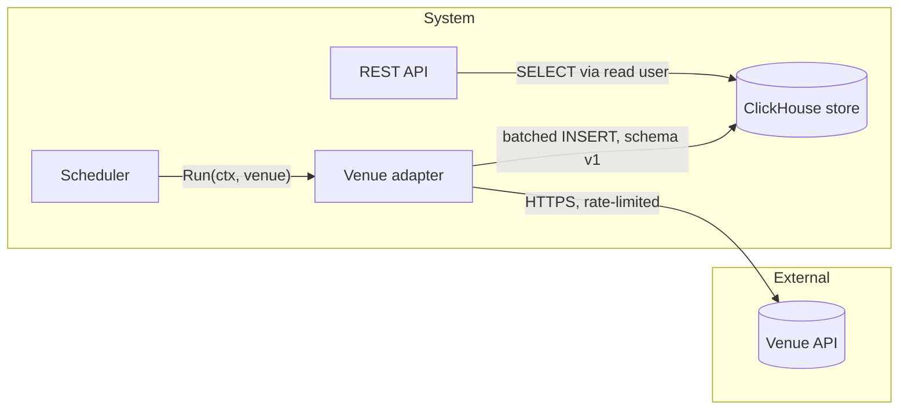
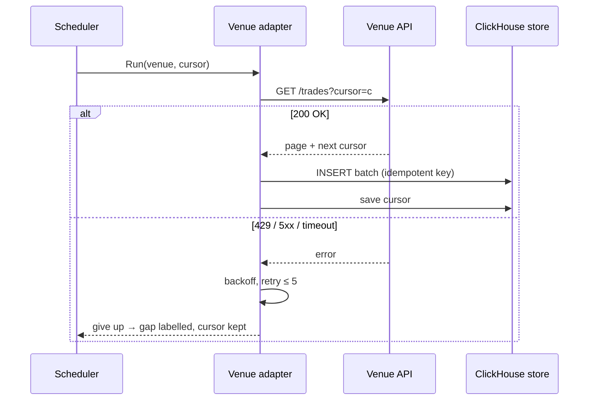
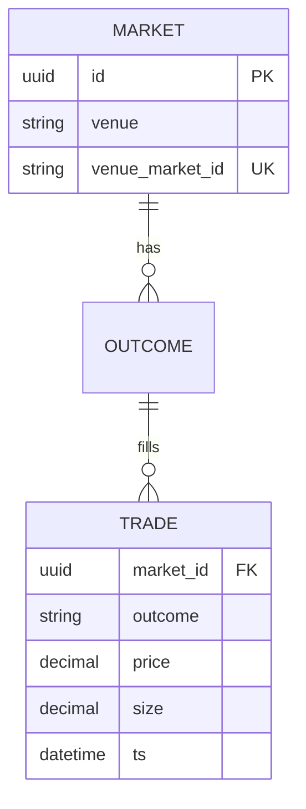

# Mermaid diagrams for architecture and design docs

The author of the doc draws its diagrams in the same pass as the text: you already
hold the component map, the contract edges and the failure paths, so the diagram is
that content drawn — not a second interpretation by someone who has to re-read it.
GitHub renders fenced ```` ```mermaid ```` blocks natively, so the doc stays the one
source everyone reads.

## What each doc must carry (enforced)

| Doc / section | Diagram | Gate code when absent |
|---|---|---|
| overview → **Components** | `flowchart` (or `C4Container`) — every listed component, edges labelled with the contract | `no-component-diagram`, `diagram-missing-component` |
| overview → **Integration contracts** | `sequenceDiagram` — at least one critical cross-component flow (one per critical flow is better) | `no-sequence-diagram` |
| component doc → **Internal structure** | `flowchart` or `classDiagram` — the parts inside the component (types, workers, queues) and how they relate | `missing-diagram` |
| component doc → **Key flows** | `sequenceDiagram` of the component's main flow, with its failure path | `missing-diagram` |
| feature architecture → **Components** | `flowchart` — every component in frontmatter `components:` and the contracts between them in this journey | `no-component-diagram`, `diagram-missing-component` |
| feature architecture → **Interactions** | `sequenceDiagram` of the journey end to end, every listed component a participant, with the failure path | `no-sequence-diagram`, `sequence-missing-component` |
| design → **Architecture** | `flowchart` — the components this design touches or adds, one level down (the modules/types inside them that change), and their contracts | `missing-diagram` |
| design → **Data flow** | `sequenceDiagram` of the main flow **including its failure/retry path** (`alt` / `else`) | `missing-diagram` |
| design → **Data model** | `erDiagram` — entities, keys, cardinality (skip only when the design is stateless and says so) | `missing-diagram` |

A diagram counts only when it has real edges (`-->`, `->>`, `||--o{` …): a fence with a
header and loose nodes fails.

## Rules

1. **Diagram = text.** Every component in the Components list appears as a node; every
   `A → B: mechanism` edge in Integration contracts appears as an arrow labelled with the
   mechanism. Nothing in the diagram that the text does not name — if the diagram needs a
   component, add it to the list (designs: `New component: <name>`).
2. **Use the documented names.** Node ids are the component names without spaces
   (`VenueAdapter`), labels are the names as written (`VenueAdapter[Venue adapter]`) — the
   gate matches names case- and space-insensitively.
3. **Show the boundary.** External systems and actors go in their own `subgraph` (or
   `System_Ext` in C4) so the reader sees what the system owns.
4. **Failure path is part of the flow.** A sequence diagram for a design shows what happens
   when the callee times out, rejects or returns partial data — retry, backoff, dead-letter,
   gap label — the same behaviour the Data flow prose states.
5. **ER matches the schema.** Entity and column names match the DDL / field table in Data
   model; mark keys (`PK`, `FK`, `UK`) and cardinality.
6. **One idea per diagram.** Split a diagram past ~15 nodes or ~12 messages; readability
   beats completeness — the lists hold the full detail.
7. **Comments with `%%`, never inside labels.** Quote labels with special characters
   (`A -->|"GET /v1/markets?cursor="| B`).

## Skeletons

Component map (overview Components / design Architecture):



Sequence with the failure path (overview Integration contracts / design Data flow):



ER model (design Data model):



## Check before handing over

```bash
node "${CLAUDE_PLUGIN_ROOT}/decision-engine/mermaid.js" docs/design/<feature>.md --require component,sequence,er
node "${CLAUDE_PLUGIN_ROOT}/decision-engine/mermaid.js" docs/architecture/overview.md --require component,sequence
node "${CLAUDE_PLUGIN_ROOT}/decision-engine/architecture-context.js" --validate
node "${CLAUDE_PLUGIN_ROOT}/decision-engine/design-gate.js" docs/design/<feature>.md
```

`mermaid.js` lists every diagram (`ok` / `no-edge`) and exits 1 when a required kind is
missing; the gates add the section placement and the component-coverage check.

## When to delegate instead

Redrawing diagrams across a whole brownfield repo from the code (a large
`/ai-sdlc:architecture refresh`) is independent work worth its own context: dispatch the
`mermaid-expert` agent and have it follow this skill.
